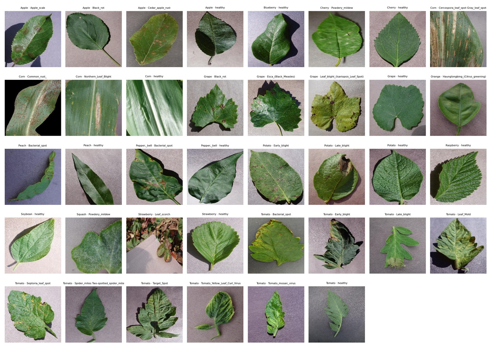

# Plant Disease Detection · Yarpaq Həkimləri

Classifies a leaf photo into one of **38 plant disease / healthy classes** (14 crops) with a
CNN and MobileNetV2 transfer learning, evaluated on a **leaf-grouped, leakage-free split**, with
Grad-CAM explanations, a "not sure" answer for low-confidence inputs, and a Gradio demo.

Neural Networks group project, Azerbaijan State Oil and Industry University, Fall 2026 (topic 06).

> **Status:** stages 1–3 of 8 done (foundation; leakage-checked data and input pipeline;
> classical baselines and a CNN from scratch); stage 4: MobileNetV2 trained and selected on
> validation (D-017); next the one-time test evaluation, then Grad-CAM and the demo.

## Results so far (validation split)

Model selection uses the validation split only; the test split has not been used yet and will
be evaluated once, on the final models.

| Model | Val macro-F1 | Val accuracy | Top-3 | Training |
|---|---|---|---|---|
| Colour/HOG/LBP + logistic regression (C = 0.1) | 0.874 | 0.900 | 0.982 | 46 s (CPU) |
| Colour/HOG/LBP + linear SVM (C = 0.1) | 0.873 | 0.904 | 0.975 | 116 s (CPU) |
| CNN from scratch (1.18 M parameters) | **0.973** | **0.980** | **0.998** | 107 min (T4, 26 epochs) |
| MobileNetV2, frozen backbone + new head | 0.916 | 0.934 | 0.988 | 15 min (T4, 10 epochs) |
| MobileNetV2, fine-tuned last 38 layers, Adam 1e-5 | 0.946 | 0.958 | 0.997 | 15 min (T4, 10 epochs) |
| MobileNetV2, fine-tuned last 38 layers, Adam 3e-5 | 0.955 | 0.968 | 0.999 | 14 min (T4, 10 epochs) |
| MobileNetV2, fine-tuned last 38 layers, Adam 1e-4 | 0.977 | **0.986** | **1.000** | 24 min (T4, 17 epochs) |
| **MobileNetV2, whole backbone fine-tuned, Adam 3e-5** | **0.977** | **0.986** | 0.999 | 39 min (T4, 18 epochs) |

The plan's 10-epoch fine-tuning runs peaked at their last epoch: they were under-trained. With up
to 30 epochs and a higher learning rate or the whole backbone trainable, MobileNetV2 overtakes
the CNN (D-017). The last two runs are tied within noise (val macro-F1 0.97738 vs 0.97722); by
the rule fixed before training (highest val macro-F1) the whole-backbone run is the final model. Per-run details: `reports/results.csv`,
`reports/runs/`; learning curves: `reports/figures/curves_*.png`.

## Why this project is different

- **Honest evaluation.** PlantVillage contains several photos of the same physical leaf, some
  of them near-identical re-shots. A random split puts them in train and test and inflates the
  score. Here every leaf and every group of near-identical images is in exactly one split,
  checked by automated tests. Known limits are stated openly (see [Data](#data)).
- **Reliability.** Grad-CAM shows what the model looked at; low-confidence inputs get
  "not sure" instead of a confident wrong answer.
- **Engineering.** Config-driven experiments, fixed seeds, tests and CI.

## Quick start

### Google Colab (recommended)

Open `notebooks/00_colab_bootstrap.ipynb` in Colab, select a T4 GPU runtime and run all cells.
It mounts Drive, installs the package, and checks the dataset and the committed splits
(every line should say `PASS`).

### Reproducing the data step

The splits in `splits/` are committed, so training does not need these steps. To rebuild or audit
them:

| Step | Where | What it does |
|---|---|---|
| `python -m plantdx.data.prepare` | any machine, ~1 min | Rebuilds `splits/*.csv` from the official index files and the grouping pairs (`splits/duplicate_pairs.csv`, `splits/sameleaf_pairs.csv`); fails if anything leaks. |
| `notebooks/01_data_audit_eda.ipynb` | Colab, ~10 min | Downloads the images, EDA figures, first (withdrawn) hash audit. |
| `notebooks/02_duplicates_and_resplit.ipynb` | Colab, ~15 min | Searches all images for near-identical pairs, measures each cut-off, writes `splits/duplicate_pairs.csv`, rebuilds and verifies the splits. |
| `notebooks/03_pipeline_check.ipynb` | Colab (T4), ~10 min | Checks the `tf.data` pipeline on the real images, saves augmentation examples, measures speed and memory. |
| `notebooks/04_sameleaf_groups.ipynb` | Colab (T4), ~35 min (~10 with cached embeddings) | Recovers the leaf groups of images without a verified leaf id with CNN embeddings calibrated on verified leaves; writes `splits/sameleaf_pairs.csv` and rebuilds the splits (D-010). |
| `python -m plantdx.data.card` | any machine | Regenerates the class table and the images-per-leaf table in `docs/data_card.md` from `splits/`. |

### Local

```bash
git clone https://github.com/AnarHummatli/plant-disease-detection.git
cd plant-disease-detection
python -m venv .venv && source .venv/bin/activate   # Windows: .venv\Scripts\activate
pip install -e ".[tf,demo,dev]"
make env     # environment report
make test    # unit tests
```

### Training and baselines

Every experiment is a YAML config that extends `configs/base.yaml`. On Colab, use
`notebooks/05_baselines.ipynb` (CPU is enough), `notebooks/06_train.ipynb` (T4 GPU, one or more
configs in a row) and, once all training is done, `notebooks/07_evaluate.ipynb` (final model and the
one-time test evaluation). They write runs to Drive and export the results for the repository. From a shell, with the images extracted to
`DATA` (the folder that contains `raw/color/`):

```bash
make baselines DATA=/content/data                          # colour/HOG/LBP + LogReg / linear SVM
make train CONFIG=configs/cnn.yaml DATA=/content/data      # CNN from scratch
make train CONFIG=configs/mobilenetv2_head.yaml DATA=...   # MobileNetV2: frozen backbone, new head
make train CONFIG=configs/mobilenetv2_ft.yaml DATA=...     # then fine-tune from the head (LR 1e-5)
make train CONFIG=configs/mobilenetv2_ft_lr3e-5.yaml DATA=...   # fine-tuning variant (LR 3e-5)
make train CONFIG=configs/mobilenetv2_ft_lr1e-4.yaml DATA=...   # D-017 A: LR 1e-4, up to 30 epochs
make train CONFIG=configs/mobilenetv2_ft_all.yaml DATA=...      # D-017 B: whole backbone, 3e-5
make eval DATA=/content/data                               # select on val, then test ONCE
```

Model selection uses validation macro-F1 only: the best run of every neural family, and the final
model is the best of those. `plantdx.evaluate` then scores every family winner and the classical
baselines on the test split, once (it refuses a second run), on the full split and on its
leaf-verified part (D-015). Every run writes `config.yaml`, `history.csv`, `best.keras` (training checkpoint),
`inference.keras` (float32, for evaluation and the demo) and `metrics_val.json` to
`<artifacts>/runs/<run_id>/` and one row to the shared results table.

## Project layout

```
configs/          experiment configs (YAML, inherit from base.yaml)
src/plantdx/      all logic: data/ (source, splits, duplicates, sameleaf, pipeline, card), baselines/,
                  models/ (cnn, mobilenet), train, export, evaluate, metrics, results, viz
notebooks/        00 bootstrap, 01 EDA + first audit, 02 duplicate search, 03 pipeline check, 04 leaf groups,
                  05 classical baselines, 06 train neural networks, 07 final model + test evaluation
splits/           train/val/test CSVs with leaf_id and group_id, grouping pairs (committed)
tests/            pytest: splits, pipeline, baselines, models, trainer, evaluation, metrics
app/gradio/       demo
docs/             problem statement, data card, decision log (later: report)
reports/figures/  every figure used in the report and this README
```

## Data

[PlantVillage](https://huggingface.co/datasets/mohanty/PlantVillage) (Hughes & Salathé, 2015;
Mohanty, Hughes & Salathé, 2016), colour variant, 54,305 images, 38 classes, licence CC BY-SA 3.0.
Images are downloaded by code and are never stored in this repository (`docs/decisions.md`, D-001).
Full description, per-class table and limitations: **[`docs/data_card.md`](docs/data_card.md)**.

| Split | Images | Leaves | Leaf id verified |
|---|---:|---:|---:|
| train | 36,779 | 13,406 | 77% |
| val | 6,121 | 2,236 | 77% |
| test (official, unchanged) | 10,709 | 4,118 | 75% |

What the data checks found (details in `docs/decisions.md`, D-004, D-006 and D-010):

- 24.3% of the images have no entry in the dataset's leaf map, so their leaf is identified only
  by file name. The official split shares 227 such file-name leaf ids between train and test.
- A first duplicate check with a perceptual hash reported 0%, but inspecting the closest pairs
  showed near-identical images it had missed, so that result was withdrawn.
- A correlation search over all 54,305 images (with flips and rotations) found that the images
  crossing the splits are **re-shots of the same leaf**, not plain copies, including in classes
  whose leaf ids come from the official leaf map. Such pairs are grouped before splitting: 43
  cross-split pairs before, 0 after.
- Verified leaves have a median of 4 photos, but file-name ids almost always hold one, so the other
  photos of those leaves were not grouped. CNN embeddings calibrated on verified leaves recover
  only the clearest cases: at 96% precision they find 0.4% of same-leaf pairs. The 565 pairs above
  that cut-off are grouped (253 crossed the splits before, 0 after). This is reported as a
  **negative result**: most hidden same-leaf pairs cannot be recovered from the images.
- In total 696 train images (1.6%) were removed; the official test set is unchanged. Because some
  leakage may remain, test results are also reported on the leaf-verified part of the test set
  (8,033 images, 30 classes), where leakage is excluded by construction.



## Disclaimer

This is an educational prototype. It gives preliminary information only, does not replace an
agronomist's diagnosis, and is not intended for safety-critical use.

## License

Code: MIT. Data: see the licences of the respective datasets.
