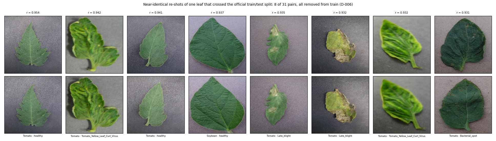
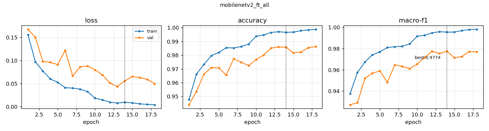
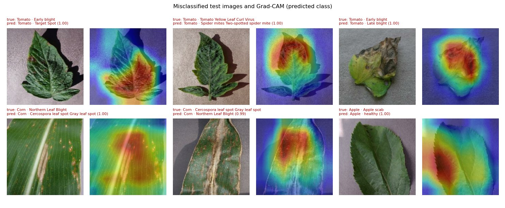
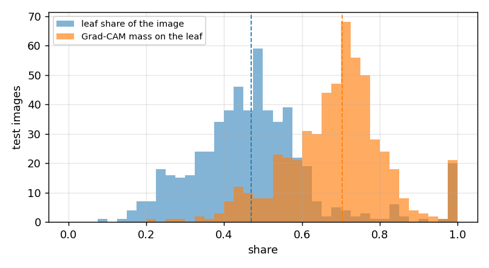

# Plant Disease Detection from Leaf Photographs: Transfer Learning on a Leakage-Checked PlantVillage Split

**Anar Hummatli** · Computer Engineering (SABAH Groups), Azerbaijan State Oil and Industry University 
Personal project · Technical report, November 2026 
Code, data checks and demo: <https://github.com/AnarHummatli/plant-disease-detection>

## Abstract

We classify a photograph of a single leaf into one of 38 classes (14 crops, 26 diseases and 12
healthy classes) of the PlantVillage dataset. Published results on this dataset are close to
perfect, but its official split is not fully grouped by physical leaf, and its photos have
class-correlated backgrounds, so a high score can come from leakage or shortcuts. We therefore
rebuilt the split around leaves and near-identical re-shots, report every test number twice (on
the full test split and on a subset where leakage is impossible by construction), and measured
with leaf masks where the network looks. A classical baseline (colour, HOG and LBP features with
logistic regression or a linear SVM), a CNN trained from scratch and MobileNetV2 transfer learning
were compared under one protocol: selection on validation only, one test evaluation. The final
model, MobileNetV2 with the whole backbone fine-tuned, reaches a test macro-F1 of 0.982 (accuracy
0.986) against 0.967 for the CNN and 0.884 for the best classical model, and 0.985 on the
leaf-verified subset, so the score is not inflated by leakage. A "not sure" threshold chosen on
validation answers 96.8% of the test images with 99.5% accuracy. The model runs in a browser demo
with Grad-CAM, and a clean-session check reproduces the reported test results exactly.

## 1. Introduction

Plant diseases are easiest to contain when they are recognised from their first visible symptoms,
but growers often cannot reach an agronomist at that moment. A quick, preliminary diagnosis from a
phone photo can tell them what the symptoms most likely indicate and when to ask an expert. The
task here is **single-label image classification**: the input is one RGB photo of one leaf, the
output is one of 38 classes shown as the top three with probabilities, or "not sure" when the
model is not confident enough. Target users are small farmers (a first opinion before paying for
treatment), agronomists and extension workers (a screening aid with a heat map) and students.

The success criteria were fixed before training: (1) test macro-F1 ≥ 0.97, evaluated once;
(2) an honest comparison with a classical baseline under the same split and protocol; (3) no leaf
shared between splits; (4) at least three failure cases explained with Grad-CAM; (5) a working
upload demo with top-3, heat map and "not sure"; (6) reproduction from the README in a clean
session. All six were met. The main contributions beyond a standard PlantVillage classifier are a leakage audit of
PlantVillage's official split, a measured (not only visual) check of where the network looks, and
a demo that runs the evaluated model unchanged in the browser.

## 2. Related work

**Deep learning on PlantVillage.** Hughes and Salathé released PlantVillage as an open image
repository for mobile disease diagnostics [1]. Mohanty et al. trained AlexNet and GoogLeNet on
it and reported 99.35% accuracy on a held-out split, but 31.4% on images from other sources taken
under different conditions [2]. Ferentinos [3] and Too et al. [4] compared several CNN architectures
and fine-tuning strategies and reported accuracies above 99%; transfer learning from ImageNet [5]
is the standard approach. MobileNetV2 [6] is designed for mobile devices, which suits a
phone-based tool.

**Limits of the dataset.** Barbedo studied how the size and variety of the training data affect
deep and transfer learning for plant disease classification [7]. PlantDoc [8] collected field images of the same kind of classes
because lab photos do not represent real use. Noyan trained a classifier on only 8 background
pixels of each PlantVillage image and reached 49.0% test accuracy against 2.6% for guessing [9]:
the backgrounds alone carry class information. More generally, Kapoor and Narayanan identify data
leakage as a widespread cause of over-optimistic results in machine-learning-based science [10].
This project takes those two risks, leakage and background shortcuts, as its main evaluation
questions rather than as footnotes.

**Explanations and classical features.** Grad-CAM [11] highlights the image regions that raise a
class score and is used here both visually and as a measured quantity. The classical baseline uses
HOG [12] and local binary patterns [13], descriptors common in pre-deep-learning plant disease
work.

## 3. Data

**Source.** PlantVillage colour images from the authors' Hugging Face release (`mohanty/PlantVillage`,
CC BY-SA 3.0) [1]: 54,305 photos of single detached leaves on plain backgrounds, all 256 × 256,
in 38 classes. Class sizes range from 152 (potato healthy) to about 5,500 (orange
Haunglongbing), a 36 : 1 imbalance, so **macro-F1 is the main metric** and accuracy is reported
but not used for selection. The release includes an official train/test split and a leaf map
that assigns photos to physical leaves.

**The leakage problem.** Most leaves were photographed several times (a median of 4 photos per
verified leaf). Photos of one leaf in both train and test would let the model recognise the leaf
instead of the disease. Three findings shaped the split (details in `docs/data_card.md` and
`docs/decisions.md`):

1. **Official split not leaf-grouped (D-004).** 24.3% of the images have no entry in the leaf
   map; for them a leaf id was taken from the file name. 227 such ids occur in both official
   train and test; their 290 train images were removed.
2. **Re-shots under different ids (D-006).** A correlation search over all 54,305 images (8
   rotations and flips, 32 → 96 px) found near-identical re-shots of one leaf filed under
   different ids, even between verified leaves. 84 pairs with correlation r ≥ 0.92 were grouped;
   31 of them crossed the official split (Figure 1). Groups that touch test were removed from
   train (196 images); cross-split near-identical pairs went from 43 to 0.
3. **Hidden same-leaf pairs (D-010).** For images without a verified id, MobileNetV2 embedding
   neighbours were calibrated on verified leaves (cosine ≥ 0.94: precision 0.96, recall 0.004).
   The 565 pairs found were grouped and 210 more train images removed. The very low recall is
   reported as a negative result: most hidden same-leaf groups cannot be recovered this way.

**Figure 1.** Eight of the 31 near-identical pairs that crossed the official train/test split
(top: train, bottom: test). All were removed from train.

**Final split.** The official test split is kept unchanged image for image (10,709 photos).
From the official train split, 696 images were removed and validation was drawn by group with
`StratifiedGroupKFold` (7 folds, seed 42), giving **train 36,779 / validation 6,121 / test
10,709**. Automated tests fail if any leaf, group or grouping pair crosses splits or if the test
split changes. Because the remaining leakage cannot be ruled out for images without a verified
leaf, every test result is also reported on the **leaf-verified subset**: 8,033 test images in 30
classes whose leaf ids are known, where leakage is excluded by construction (8 classes have no
verified ids at all).

## 4. Method

**Input pipeline.** Images are decoded as RGB, resized to 224 × 224 (bilinear, antialiased) and
passed as 0–255 floats; each model scales them itself, so the demo calls the same model on raw
pixels. Training-only augmentation runs on the GPU as the first layers of the model: random
horizontal and vertical flips, rotation up to ±20°, zoom ±15%, brightness and contrast ±15%.

**Classical baseline.** An HSV colour histogram (96 values), HOG (1,764) and a uniform LBP
histogram (10) at 128 × 128 per image. HOG is standardised and reduced to 256 PCA components;
colour and LBP are kept, and all features are standardised again. Logistic regression and a
linear SVM with balanced class weights; C ∈ {0.01, 0.1, 1, 10} chosen on validation macro-F1.

**CNN from scratch.** Four VGG-style blocks of two 3 × 3 convolutions (32, 64, 128, 256 filters),
each followed by batch normalisation and ReLU, with max pooling after each block; global average
pooling, dropout 0.3 and a 38-way softmax (1,184,902 parameters). Two convolutions per block give
a 76 px receptive field instead of 46 px with one, enough to see a lesion with its surroundings.

**MobileNetV2 transfer learning** [6]. ImageNet weights, input scaled to [−1, 1] inside the model,
global average pooling, dropout 0.2 and a new 38-way softmax (2,306,662 parameters). Batch
normalisation layers stay frozen in inference mode throughout. Training goes in two phases: the
**head** alone on a frozen backbone (48,678 trainable parameters), then **fine-tuning** from the
best head checkpoint, either from `block_13_expand` on (1,712,038 trainable parameters) or the
whole backbone from `Conv1` (2,238,438).

**Training protocol.** Categorical cross-entropy, Adam [14], batch size 64, mixed precision on an
NVIDIA T4 (Google Colab). The checkpoint keeps the epoch with the best validation macro-F1;
early stopping (patience 5) and learning-rate halving (patience 2) watch the smoother validation
loss. Learning rates: 1e-3 for the CNN (up to 30 epochs) and the head (10 epochs); 1e-5, 3e-5 and
1e-4 for fine-tuning the last layers; 3e-5 for the whole backbone (up to 30 epochs). The tuning
budget was one configuration for the CNN and five for MobileNetV2, stated for a fair comparison.

**Selection and the test rule (D-015).** Each family's best configuration is chosen on
validation macro-F1, the final model is the best of these, and each chosen model is scored on
test **exactly once**; the code refuses a second test evaluation of a run.

**"Not sure" answer (D-019).** The rule was fixed before computing it: the smallest threshold
on the top probability for which the answered validation images are at least 99.5% correct.

**Grad-CAM (D-022).** Heat maps use the gradient of the class score before the softmax. For the
global-average-pooling head this equals the class activation map. The gradient of the
probability, used at first, vanishes when the probability is 1.0 (42% of test images), which made
those maps noise.

## 5. Experiments and results

### 5.1 Model selection on validation

| Run | Trainable params | Val macro-F1 | Val acc. | Best / last epoch |
|---|--:|--:|--:|--:|
| Features + logistic regression (C = 0.1) | — | 0.8736 | 0.900 | — |
| Features + linear SVM (C = 0.1) | — | 0.8733 | 0.904 | — |
| CNN from scratch | 1,182,982 | 0.9732 | 0.980 | 25 / 26 |
| MobileNetV2, frozen backbone (head) | 48,678 | 0.9158 | 0.934 | 8 / 10 |
| MobileNetV2, last 38 layers, Adam 1e-5 | 1,712,038 | 0.9456 | 0.958 | 10 / 10 |
| MobileNetV2, last 38 layers, Adam 3e-5 | 1,712,038 | 0.9551 | 0.968 | 10 / 10 |
| MobileNetV2, last 38 layers, Adam 1e-4 | 1,712,038 | 0.9772 | 0.986 | 12 / 17 |
| **MobileNetV2, whole backbone, Adam 3e-5** | 2,238,438 | **0.9774** | 0.986 | 14 / 18 |

**Table 1.** Validation results of every configuration trained. The CNN has 1,184,902 parameters
in total and MobileNetV2 2,306,662; batch-normalisation statistics are not trainable.

With the plan's settings MobileNetV2 stayed below the CNN, and both fine-tuning runs had their
best epoch at the last one, with validation macro-F1 still rising: the network was under-trained
rather than unsuitable. Two variants tested the two explanations (a higher learning rate; all
layers trainable) and both overtook the CNN. They are tied within noise (difference 0.00016);
the rule fixed beforehand, highest validation macro-F1, selected the whole-backbone model. Its
learning curves (Figure 2) show the validation loss at its lowest at epoch 13 and the best
validation macro-F1 at epoch 14, the checkpoint kept; early stopping ended the run at epoch 18.

**Figure 2.** Training and validation loss, accuracy and macro-F1 of the final model; the dotted
line marks the selected epoch.

### 5.2 Test results and baseline comparison

| Model | Test macro-F1 | Test acc. | Verified macro-F1 | Top-3 | Size | CPU ms |
|---|--:|--:|--:|--:|--:|--:|
| **MobileNetV2, fine-tuned (final)** | **0.9816** | **0.9859** | **0.9849** | 0.9996 | 9.8 MB | 239 |
| CNN from scratch | 0.9671 | 0.9766 | 0.9708 | 0.9989 | 4.9 MB | 147 |
| Features + logistic regression | 0.8839 | 0.9055 | 0.8807 | 0.9822 | 2.0 MB | 19 |
| Features + linear SVM | 0.8731 | 0.9012 | 0.8692 | 0.9770 | 2.0 MB | 19 |

**Table 2.** Test results, one evaluation per model. CPU time per image at batch size 1 with
eager Keras on Colab's 2-core CPU, including feature extraction; compiled for the demo, the final
model takes 39 ms with Grad-CAM.

Both neural networks beat the classical baselines by 8–11 points of macro-F1, and transfer
learning beats the CNN from scratch by 1.5 points, at twice the size and 1.6 times the CPU time.
The classical models keep a high top-3 accuracy (0.98) but confuse visually similar diseases
that hand-crafted colour and texture statistics cannot separate.

**Does leakage inflate the score?** Restricted to the 30 classes with verified leaves, the full
test gives macro-F1 0.9848 and the leaf-verified images 0.9849: no difference, so photos of
leaves shared with train do not raise the score. The gap between 0.982 on all 38 classes and
0.985 comes from the 8 classes without verified leaves, which include the hardest ones (corn
Cercospora leaf spot, tomato target spot). On the 1,050 unverified test images of the verified
classes, accuracy is 0.983, slightly *below* the verified images (0.987). The subset lacks
8 classes, so this is strong evidence, not a proof.

### 5.3 Error analysis

The final model makes 151 errors on 10,709 test images. The weakest classes are tomato early
blight (F1 0.885, recall 0.805), corn Cercospora leaf spot (0.912), tomato target spot (0.935),
potato healthy (0.952, only 32 test images) and corn northern leaf blight (0.954). The most
frequent confusions follow real visual similarity: tomato early blight → target spot (21 images,
9.8% of the class; both form brown spots with concentric rings), tomato yellow leaf curl virus →
spider mites (10; both cause fine yellow stippling), early → late blight (10), and the two corn
diseases in both directions (10 and 8; close-ups hide the lesion length that separates them).
32 errors (21%) predict another crop, mostly healthy leaves of similar shape and tomato versus
potato late blight, which is the same pathogen (*Phytophthora infestans*).

**Figure 3.** The most confident error of each of the five main confusion pairs and one other
error; right of each photo, Grad-CAM for the predicted class.

In all six failure cases of Figure 3 the heat map lies on the leaf and on the lesions, and each
error matches a real visual ambiguity: too few spots to tell the two ringed-spot diseases apart,
a late-stage leaf where both blights look alike, a corn close-up without the long lesions of
northern leaf blight. The apple-scab photo shows almost no symptoms and may be an early
infection or a doubtful label. What the model lacks is doubt: it gives these errors
probabilities of 0.99–1.00.

### 5.4 Does the model look at the leaf?

The segmented variant of PlantVillage provides a leaf mask for each photo. On 555 test images (up
to 15 per class) we measured the share of the Grad-CAM mass that falls on the leaf. The median
is **0.70**, while the leaf covers a median **0.47** of the image (Figure 4); for 97% of the
images the heat map is more concentrated on the leaf than its area alone would give, and for 8%
less than half of it is on the leaf. The lowest class medians are peach healthy (0.43), tomato
mosaic virus (0.49) and apple healthy (0.58), healthy or subtly mottled leaves where the
evidence is the leaf's overall texture and outline. Given that backgrounds alone predict the class
far above chance [9], this is the evidence that the final model mainly uses the leaf.

**Figure 4.** Share of the image covered by the leaf (blue) and share of the Grad-CAM mass on the
leaf (orange) for 555 test images; dashed lines are the medians.

### 5.5 Confidence threshold

The rule of Section 4 gives a threshold of **0.947**. On validation 96.4% of the images are
answered with 99.51% accuracy. Applied unchanged to test, 96.8% are answered with 99.51%
accuracy: 100 of the 151 errors are turned into "not sure", at the cost of 245 correct answers
(2.3%) held back. The other 51 errors have probabilities close to 1, the over-confidence seen in
Figure 3, which a threshold cannot catch.

### 5.6 Prototype and reproducibility

**Demo.** A static web page runs the final model on the user's device with ONNX Runtime Web
(<https://huggingface.co/spaces/AnarHummatli/plant-disease-detection>, also on GitHub Pages), so
photos are never uploaded. It shows the diagnosis or "not sure", the top three classes, the
Grad-CAM overlay and limitations, in English and Azerbaijani. The ONNX export outputs the
probabilities and the 7 × 7 class activation map, and is checked against Keras on every build
(probabilities within 10⁻⁶). The photo is cropped to its centred square and resized by a
JavaScript port of TensorFlow's resize that is bit-identical to it; on 47 photos the browser
gave the same class and verdict as Python. One photo takes about 35 ms in single-threaded
WebAssembly. A Gradio app with the same functions runs locally or from a Colab notebook, and a
74-second video in the release records the demo for presenting without internet.

**Reproducibility.** One command (`make reproduce`, or notebook 10 on Colab) compares a fresh
environment with every reported number. In a new Colab session all 11 checks passed: the six
split files rebuilt byte-identical from the official index files; the released model gave the
reported test macro-F1 (0.9816) and accuracy with the same 151 errors (0 of 10,709 predictions
different) and the same "not sure" figures; the demo examples and the ONNX export matched; and the
head model trained again from scratch reached validation macro-F1 0.9198 against the reported
0.9158 (GPU training is not bit-deterministic). Re-scoring the frozen released model reproduces
published numbers and changes no decision, so the test split remains used once for every
decision. The exact package versions are pinned in `requirements.lock`, and 186 automated tests
run in continuous integration on Python 3.11–3.13.

## 6. Limitations

- **Lab images.** Every photo shows one detached leaf on a plain background. Accuracy on field
  photos with several leaves, soil and shadows is expected to be much lower [2], [8] and was not
  measured; the demo says so.
- **Residual leakage.** For 24.3% of the images the true leaf is unknown and most of their
  re-shots cannot be recovered (recall 0.004). The verified subset shows no inflation, but it
  covers 30 of 38 classes.
- **Closed set.** Crops and diseases outside the 38 classes are not rejected; they receive the
  closest class, often confidently. The threshold is not an out-of-distribution detector.
- **Over-confidence.** Errors come with probabilities near 1, so the reported confidence is not
  calibrated.
- **Small classes and labels.** Potato healthy has 32 test images, so its scores are noisy; label
  quality was not audited beyond the inspected failure cases.

## 7. Future work

1. **Field evaluation** on PlantDoc [8] and own phone photos of local crops, followed by
   fine-tuning on mixed lab and field data.
2. **Calibration** with temperature scaling [15] so that probabilities and the "not sure" answer
   become meaningful for confident errors.
3. **Out-of-distribution rejection** of photos that are not one of the 38 classes or not a leaf.
4. **Crop-conditioned answers:** the user knows the crop, and restricting the output to it would
   remove the 21% of errors that predict another crop.
5. **Stronger leaf grouping** for the 24.3% of images without verified ids, for example with
   image matching instead of global embeddings.

## 8. Conclusion

On PlantVillage, transfer learning with MobileNetV2 reaches a test macro-F1 of 0.982, clearly
above a CNN trained from scratch (0.967) and a classical baseline (0.884). The more important
result is that the number can be trusted within the dataset's limits: the split was rebuilt
around leaves and re-shots, the leaf-verified subset scores the same, the network's attention is
measured to lie mainly on the leaf, and a clean session reproduces the results exactly. The main
open problem is the gap between lab photos and the field.

## Use of generative AI

Claude (Anthropic), an AI assistant, was used during the project: to discuss approaches, to write
and review code and tests, to analyse results and to draft and edit the documentation and this
report. The author directed the work, made the final decisions, ran all training and evaluation
on Google Colab and checked the results, and is responsible for the content. Every number in this
report comes from the project's logged outputs (`reports/`), and the reproduction check of
Section 5.6 recomputes them in a clean session.

## References

[1] D. P. Hughes and M. Salathé, "An open access repository of images on plant health to enable
the development of mobile disease diagnostics," arXiv:1511.08060, 2015.

[2] S. P. Mohanty, D. P. Hughes and M. Salathé, "Using deep learning for image-based plant
disease detection," *Frontiers in Plant Science*, vol. 7, 1419, 2016.

[3] K. P. Ferentinos, "Deep learning models for plant disease detection and diagnosis,"
*Computers and Electronics in Agriculture*, vol. 145, pp. 311–318, 2018.

[4] E. C. Too, L. Yujian, S. Njuki and L. Yingchun, "A comparative study of fine-tuning deep
learning models for plant disease identification," *Computers and Electronics in Agriculture*,
vol. 161, pp. 272–279, 2019.

[5] J. Deng, W. Dong, R. Socher, L.-J. Li, K. Li and L. Fei-Fei, "ImageNet: A large-scale
hierarchical image database," in *Proc. CVPR*, 2009, pp. 248–255.

[6] M. Sandler, A. Howard, M. Zhu, A. Zhmoginov and L.-C. Chen, "MobileNetV2: Inverted residuals
and linear bottlenecks," in *Proc. CVPR*, 2018, pp. 4510–4520.

[7] J. G. A. Barbedo, "Impact of dataset size and variety on the effectiveness of deep learning
and transfer learning for plant disease classification," *Computers and Electronics in
Agriculture*, vol. 153, pp. 46–53, 2018.

[8] D. Singh, N. Jain, P. Jain, P. Kayal, S. Kumawat and N. Batra, "PlantDoc: A dataset for
visual plant disease detection," in *Proc. ACM IKDD CoDS and COMAD*, 2020,
doi:10.1145/3371158.3371196.

[9] M. A. Noyan, "Uncovering bias in the PlantVillage dataset," arXiv:2206.04374, 2022.

[10] S. Kapoor and A. Narayanan, "Leakage and the reproducibility crisis in
machine-learning-based science," *Patterns*, vol. 4, no. 9, 100804, 2023.

[11] R. R. Selvaraju, M. Cogswell, A. Das, R. Vedantam, D. Parikh and D. Batra, "Grad-CAM:
Visual explanations from deep networks via gradient-based localization," in *Proc. ICCV*, 2017,
pp. 618–626.

[12] N. Dalal and B. Triggs, "Histograms of oriented gradients for human detection," in *Proc.
CVPR*, 2005, pp. 886–893.

[13] T. Ojala, M. Pietikäinen and T. Mäenpää, "Multiresolution gray-scale and rotation invariant
texture classification with local binary patterns," *IEEE TPAMI*, vol. 24, no. 7, pp. 971–987,
2002.

[14] D. P. Kingma and J. Ba, "Adam: A method for stochastic optimization," in *Proc. ICLR*, 2015.

[15] C. Guo, G. Pleiss, Y. Sun and K. Q. Weinberger, "On calibration of modern neural networks,"
in *Proc. ICML*, 2017, pp. 1321–1330.

**Software.** TensorFlow 2.21 and Keras 3.13 (training), scikit-learn (baselines and metrics),
ONNX Runtime and ONNX Runtime Web with tf2onnx (browser demo), Gradio (local demo), on Google
Colab with an NVIDIA T4 GPU. Pretrained weights: MobileNetV2 on ImageNet from Keras Applications.
